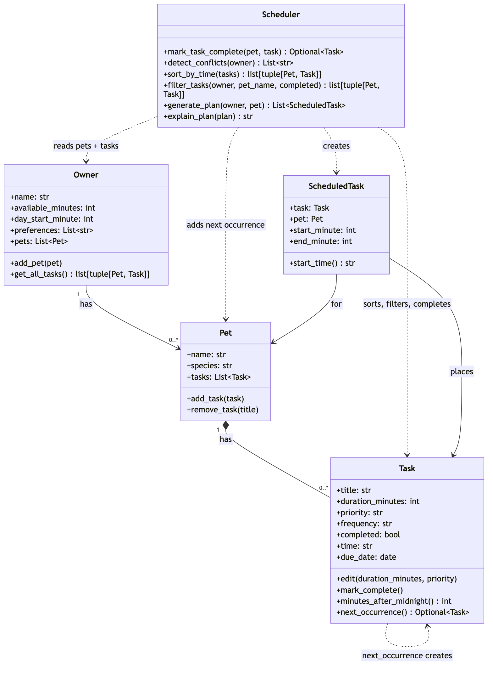

# PawPal+ (Module 2 Project)

You are building **PawPal+**, a Streamlit app that helps a pet owner plan care tasks for their pet.

## Scenario

A busy pet owner needs help staying consistent with pet care. They want an assistant that can:

- Track pet care tasks (walks, feeding, meds, enrichment, grooming, etc.)
- Consider constraints (time available, priority, owner preferences)
- Produce a daily plan and explain why it chose that plan

Your job is to design the system first (UML), then implement the logic in Python, then connect it to the Streamlit UI.

## What you will build

Your final app should:

- Let a user enter basic owner + pet info
- Let a user add/edit tasks (duration + priority at minimum)
- Generate a daily schedule/plan based on constraints and priorities
- Display the plan clearly (and ideally explain the reasoning)
- Include tests for the most important scheduling behaviors

## Getting started

### Setup

```bash
python -m venv .venv
source .venv/bin/activate  # Windows: .venv\Scripts\activate
pip install -r requirements.txt
```

### Suggested workflow

1. Read the scenario carefully and identify requirements and edge cases.
2. Draft a UML diagram (classes, attributes, methods, relationships).
3. Convert UML into Python class stubs (no logic yet).
4. Implement scheduling logic in small increments.
5. Add tests to verify key behaviors.
6. Connect your logic to the Streamlit UI in `app.py`.
7. Refine UML so it matches what you actually built.

## 🧩 Implementation Summary

The logic layer lives in `pawpal_system.py` and is built from five classes:

- **`Task`**: one care activity (title, duration, priority, frequency, completion status, optional `HH:MM` time, due date). `edit()` updates it, and `mark_complete()` marks it done.
- **`Pet`**: a pet (name, species) that owns its list of tasks through `add_task()` and `remove_task()`.
- **`Owner`**: the person doing the care. Stores their daily time budget, day start time, preferences, and pets. `get_all_tasks()` returns every `(pet, task)` pair across all pets, which is the single entry point for multi-pet data.
- **`ScheduledTask`**: a task placed at a specific start minute for a specific pet, with `end_minute` and `start_time()` for display.
- **`Scheduler`**: the planner. `generate_plan()` will turn the owner's tasks into a list of `ScheduledTask`s, and `explain_plan()` will describe why each was chosen. These two methods are not implemented yet.

**How they work together:** an `Owner` holds `Pet`s, each `Pet` holds `Task`s, and code that needs every task asks the owner via `get_all_tasks()` instead of reaching into individual pets. Times are stored as minutes after midnight so tasks can be placed back to back with simple addition, then formatted as `HH:MM` only for display.



The diagram source is [`diagrams/uml_final.mmd`](diagrams/uml_final.mmd). The original Phase 1 draft is kept in [`diagrams/uml_draft.mmd`](diagrams/uml_draft.mmd) for comparison.

`main.py` is a command-line demo of the `Scheduler` features: it builds an owner with two pets, completes two recurring tasks, then prints the tasks sorted, filtered, and checked for conflicts (see **Demo Walkthrough** below). `tests/test_pawpal.py` covers sorting, filtering, conflict detection, and recurring tasks (see **Testing PawPal+** below).

## ✨ Features

- **Multi-pet task tracking:** one owner can have several pets, each with its own task list. `Owner.get_all_tasks()` returns every task paired with its pet, so the scheduler works across all pets at once.
- **Sorting by time:** `Scheduler.sort_by_time()` orders tasks by due date, then by start time converted to minutes after midnight. Comparing numbers instead of text means `"7:30"` correctly comes before `"18:00"`. Tasks with no set time go to the end of their day, and tasks with the same time keep the order they were added in.
- **Filtering by pet and status:** `Scheduler.filter_tasks()` narrows the list to one pet (case-insensitive), to done or unfinished tasks, or to both at once. Filtered results can be passed straight into the sort.
- **Conflict warnings:** `Scheduler.detect_conflicts()` flags any two unfinished tasks on the same day whose time windows overlap, using the interval test `a.start < b.end and b.start < a.end`. It catches partial overlaps and clashes between different pets, while back-to-back tasks are allowed. It returns readable warnings instead of raising an error, so a bad schedule never crashes the app.
- **Daily and weekly recurrence:** `Scheduler.mark_task_complete()` marks a task done and, if it repeats, adds a fresh copy due 1 day (daily) or 7 days (weekly) later, calculated with `timedelta` so month and year rollover work. One-time tasks don't repeat, and completing the same task twice doesn't create a duplicate.
- **Time validation:** `Task.minutes_after_midnight()` parses times with `datetime.strptime(..., "%H:%M")`, so impossible times like `"25:00"` or `"7pm"` are rejected. The app shows a clear error instead of saving a bad task.
- **Edit and remove tasks (app only):** the Streamlit app can move an unfinished task to a new start time (validated the same way) or remove it, which is how an owner resolves a conflict warning. Removal deletes only the selected task, so tomorrow's copy of a daily task with the same title is kept.
- **Data persistence:** pets, tasks, and owner settings are saved to `data.json` and reloaded the next time the app starts. See **💾 Data Persistence** below.
- **Daily time budget check (app only):** the Streamlit app adds up today's unfinished task minutes and warns when they exceed the owner's available minutes.

**Not built yet:** `Scheduler.generate_plan()` and `explain_plan()`, which would choose tasks by priority to fit the time budget and explain each choice, are still stubs. For now, today's schedule (in both the app and `main.py`) is every unfinished task due today, in time order.

See **Smarter Scheduling** below for how each algorithm works.

## 🧪 Testing PawPal+

Run the full suite from the project root (with the virtual environment activated):

```bash
python -m pytest
```

### What the tests cover

The 49 tests in `tests/test_pawpal.py` cover both the happy path and edge cases for each scheduler feature:

- **Sorting:** tasks come back in chronological order, by date first and then by time. Tasks with no time go last within their own day. Tasks with identical times keep their original order. `"7:30"` and `"07:30"` sort the same, and the input list is not modified.
- **Recurrence:** completing a daily task creates a new, incomplete copy for the next day, and a weekly task repeats 7 days later. Dates roll over correctly at year end and in leap years. `"once"` tasks and unknown frequencies don't repeat, and completing a task twice doesn't create a duplicate.
- **Conflict detection:** two tasks at the exact same time are flagged, as are partial overlaps, one task inside another, and overlaps between different pets. Back-to-back tasks and the same time on different days are not flagged. Completed and untimed tasks are ignored. An invalid time like `"25:00"` produces a warning instead of a crash.
- **Filtering:** by pet name (case-insensitive), by completion status, or both.
- **Empty data:** a pet with no tasks, an owner with no pets, an empty list, and a pet name that doesn't exist.
- **Persistence:** a save/load round trip restores every field (including dates), a missing file loads as `None`, saves leave no temp files behind, and corrupt or newer-version files raise `ValueError` instead of loading bad data.
- **Time parsing:** `"07:30"` converts to 450 minutes, and impossible times like `"25:00"`, `"12:60"` or `"7pm"` are rejected.

All tests use a fixed date, so results don't depend on the day you run them.

### Sample test output

```
$ python -m pytest
============================= test session starts ==============================
platform darwin -- Python 3.13.3, pytest-9.1.1, pluggy-1.6.0
rootdir: /Users/adonias/Desktop/codepath/ai110-module2show-pawpal-starter
plugins: anyio-4.15.1
collected 37 items

tests/test_pawpal.py .....................................               [100%]

============================== 37 passed in 0.02s ==============================
```

### Confidence level: ⭐⭐⭐⭐☆ (4/5)

Sorting, filtering, conflict detection, and recurrence are well tested, including their edge cases. Writing the tests also uncovered two real bugs, which are now fixed: unpadded times like `"7:30"` sorted after `"18:00"`, and completing a task twice created a duplicate next occurrence. It's not 5 stars for three reasons:

- `generate_plan()` and `explain_plan()` aren't implemented yet, so the owner's time budget and priorities aren't tested.
- A task that runs past midnight (e.g. 23:30 for 60 minutes) isn't checked against tasks the next morning.
- The Streamlit UI in `app.py` is only tested by hand.

## 📐 Smarter Scheduling

Beyond storing tasks, the `Scheduler` in `pawpal_system.py` can sort, filter, check for time conflicts, and handle recurring tasks. Run `python main.py` to see each feature in action.

| Feature | Method(s) | Notes |
|---------|-----------|-------|
| Task sorting | `Scheduler.sort_by_time()` | By due date, then start time in minutes; tasks with no set time go last each day |
| Filtering | `Scheduler.filter_tasks()` | By pet name, completion status, or both |
| Conflict handling | `Scheduler.detect_conflicts()`, `Task.minutes_after_midnight()` | Flags overlapping time windows (same or different pets) as warnings, never crashes |
| Recurring tasks | `Scheduler.mark_task_complete()`, `Task.next_occurrence()` | Completing a daily/weekly task automatically creates the next one |

### Sorting: `Scheduler.sort_by_time(tasks)`

Takes a list of `(pet, task)` pairs and returns a new list in chronological order: first by `due_date`, then by start time. It uses `sorted()` with a key function that converts each time with `Task.minutes_after_midnight()`:

```python
def sort_key(pair):
    task = pair[1]
    try:
        return (task.due_date, False, task.minutes_after_midnight())
    except ValueError:  # no time set ("") or malformed
        return (task.due_date, True, 0)
```

- Sorting on minutes instead of the raw text means `"7:30"` and `"07:30"` sort the same. As plain text, `"7:30"` would sort after `"18:00"`.
- The middle value is `False` for timed tasks and `True` for untimed or invalid ones. Since `False` sorts first, tasks with no usable time land at the end of each day.
- The input list is not modified.

### Filtering: `Scheduler.filter_tasks(owner, pet_name=None, completed=None)`

Returns the owner's `(pet, task)` pairs that match the given filters.

- `pet_name="Milo"` keeps only Milo's tasks (case-insensitive).
- `completed=False` keeps unfinished tasks; `completed=True` keeps finished ones.
- Both filters can be combined, and leaving one as `None` means "don't filter on that".
- The output can be passed straight into `sort_by_time()`, e.g. "today's unfinished tasks in time order".

### Conflict detection: `Scheduler.detect_conflicts(owner)`

Returns a list of warning strings (empty if there are no problems) instead of raising, so a bad schedule never crashes the app.

- Two incomplete tasks conflict when they share a due date **and** their time windows overlap: `a.start < b.end and b.start < a.end`. This catches partial overlaps (a 30-minute walk at 07:00 clashes with a task at 07:15), not just identical start times.
- Works for the same pet (`Leo - 'Morning walk' overlaps 'Medication'`) and across pets (`Leo and Milo - 'Vet call' overlaps 'Feeding'`).
- Back-to-back tasks (one ends exactly when the next starts) are not conflicts.
- Times are parsed by `Task.minutes_after_midnight()`, which uses `datetime.strptime(..., "%H:%M")`. Invalid times like `"7pm"` or `"25:00"` produce a warning and are skipped.
- Completed tasks and tasks with no set time are ignored.
- Every pair is compared with `itertools.combinations`. This is O(n²), chosen on purpose for readability; a day's worth of pet tasks is small enough that it runs instantly (see the tradeoff in `reflection.md`).

### Recurring tasks: `Scheduler.mark_task_complete(pet, task)`

Marks a task done and, if it repeats, adds its next occurrence to the pet.

- `Task.next_occurrence()` builds the copy with `dataclasses.replace`, keeping the title, duration, priority, and time but resetting `completed` to `False`.
- The new due date is calculated with `timedelta`: `+ timedelta(days=1)` for `"daily"`, `+ timedelta(weeks=1)` for `"weekly"`. `timedelta` handles month and year rollover (Dec 31 → Jan 1).
- `"once"` tasks are just marked complete; no new task is created and the method returns `None`.
- Completing a task that is already done does nothing and returns `None`, so a double click can't create a duplicate next occurrence.
- Calling `Task.mark_complete()` directly still only marks the task done, without creating a next occurrence.

## 💾 Data Persistence

PawPal+ remembers your pets and tasks between runs by saving them to `data.json` in the project folder.

- **Serialization:** `Task`, `Pet`, and `Owner` each have `to_dict()` / `from_dict()`. Dates are stored as ISO strings (`"2026-10-19"`) and turned back into `date` objects on load. Missing optional fields fall back to their defaults and unknown keys are ignored, so older files still load.
- **Saving:** `Owner.save_to_json(path="data.json")` writes the owner, every pet, and every task, plus a `version` number and a `saved_at` timestamp. The write is **atomic**: it goes to a temp file first and then replaces `data.json` in one step, so a crash mid-save can't leave a half-written file.
- **Loading:** `Owner.load_from_json(path="data.json")` returns the saved `Owner`, or `None` on the first run when there's no file yet. Bad JSON, missing fields, bad dates, or a file from a newer schema version raise `ValueError`.
- **In the app:** data loads automatically on startup and auto-saves after any change (only when something actually changed). If `data.json` is damaged, the app moves it to `data.json.corrupt-<timestamp>`, shows a warning, and starts fresh rather than crashing or overwriting it. The sidebar shows when data was last saved, offers a **Download backup** button, and has a confirm-protected **Start over** to erase everything. To restore a backup, rename it to `data.json`.

Example `data.json`:

```json
{
  "version": 1,
  "saved_at": "2026-10-19T08:15:02",
  "owner": {
    "name": "Jordan",
    "available_minutes": 120,
    "day_start_minute": 480,
    "preferences": [],
    "pets": [
      {
        "name": "Mochi",
        "species": "dog",
        "tasks": [
          {"title": "Morning walk", "duration_minutes": 20, "priority": "high", "frequency": "daily",
           "completed": false, "time": "07:30", "due_date": "2026-10-19"}
        ]
      }
    ]
  }
}
```

`data.json` is listed in `.gitignore`, since it holds your personal data rather than code.

## 📸 Demo Walkthrough

### Running the app

```bash
streamlit run app.py
```

The app is a single page with four sections, from top to bottom:

| Section | What you can do |
|---------|-----------------|
| **Owner** | Set the owner's name and how many minutes they have for pet care today. |
| **Pets** | Add a pet with a name and species (dog, cat, other). Empty or duplicate names are rejected. A table lists each pet and how many tasks it has. |
| **Tasks** | Add a task for a chosen pet: title, duration, optional start time (`HH:MM`), priority, and how often it repeats (daily, weekly, once). Under **Find tasks**, filter by pet and by status (To do / Done / All); results appear in a table sorted by date and time, with priority shown as 🔴 high / 🟡 medium / 🟢 low. Under **Update a task**, pick an unfinished task and either **Mark done**, **Change time** (enter a new `HH:MM`, or leave blank for anytime), or **Remove task**. |
| **Today's Schedule** | See conflict warnings, a summary of tasks today vs. minutes needed vs. minutes available, a warning if today's tasks don't fit the time budget, and today's unfinished tasks in time order. |

### Example workflow

1. **Set up the owner.** Leave the owner as Jordan with 120 available minutes.
2. **Add two pets.** Add Mochi (dog) and Luna (cat). Both appear in the pets table with 0 tasks.
3. **Add tasks.**
   - Mochi: "Morning walk", 30 min, `07:00`, high, daily
   - Mochi: "Medication", 5 min, `07:15`, high, daily
   - Luna: "Feeding", 10 min, `07:30`, high, daily
   - Luna: "Brushing", 20 min, no start time, low, weekly
   - Luna: "Play time" at `7pm` is rejected with: *'7pm' isn't a valid time. Use 24-hour HH:MM, like 07:30 or 18:00.*
4. **View the sorted task list.** **Find tasks** shows the four tasks in time order: 07:00 walk, 07:15 medication, 07:30 feeding, and Brushing last, marked "anytime" because it has no set time.
5. **Check today's schedule.** A yellow warning appears: **1 scheduling conflict(s) found**, followed by *Mochi - 'Morning walk' (07:00) overlaps 'Medication' (07:15)* and the date, plus a tip to fix it under **Update a task**. Luna's 07:30 feeding is *not* flagged, because it starts exactly when the walk ends. The summary shows 4 tasks today, 65 minutes needed, and 120 available.
6. **Fix the conflict.** Under **Update a task**, choose Mochi's Medication, enter `07:45` as the new start time, and click **Change time**. The app confirms *Moved Mochi's 'Medication' to 07:45.* and the warning is replaced by *No time conflicts. Every timed task has its own slot.* An invalid time like `7pm` is rejected here too, and the task keeps its old time.
7. **Complete a recurring task.** Choose Mochi's Morning walk and click **Mark done**. The app confirms: *Nice! 'Morning walk' is done for Mochi. The next one is scheduled for Monday, Oct 19.* (always the next day for a daily task). Today's summary drops to 3 tasks and 35 minutes, and tomorrow's Morning walk appears in **Find tasks** as a new to-do.
8. **Remove a task.** Choose Luna's Brushing and click **Remove task**. The app confirms *Removed Luna's 'Brushing'.* and today's summary drops to 2 tasks and 15 minutes.

### Scheduler behaviors shown

- **Sorting:** tasks are always listed by date, then time, with untimed tasks at the end of each day (`sort_by_time`).
- **Filtering:** the pet and status filters, the "Update a task" list (unfinished tasks only), and today's schedule all use `filter_tasks`.
- **Conflict warnings:** overlapping tasks are flagged with the pet, both task names, and both times. Back-to-back tasks and completed tasks are not flagged (`detect_conflicts`).
- **Recurrence:** completing a daily or weekly task automatically creates the next one with a later due date (`mark_task_complete`).
- **Validation:** invalid times are rejected when a task is added or its time is changed (`minutes_after_midnight`).

### Sample CLI output

`main.py` runs the same scheduler features without the UI. It sets up Jhon with a dog (Leo) and a cat (Milo), adds tasks out of time order, includes two deliberate clashes, and completes one daily task (Leo's Feeding) and one weekly task (Milo's Brushing). Dates depend on the day you run it.

```
$ python main.py
All tasks (insertion order)
----------------------------------------
  18:00  Leo    Evening walk         due 2026-10-18  [todo]
  07:30  Leo    Feeding              due 2026-10-18  [done]
  07:00  Leo    Morning walk         due 2026-10-18  [todo]
  07:00  Leo    Medication           due 2026-10-18  [todo]
  08:00  Leo    Vet call             due 2026-10-18  [todo]
  07:30  Leo    Feeding              due 2026-10-19  [todo]
  --:--  Milo   Brushing             due 2026-10-18  [done]
  12:15  Milo   Litter box cleanup   due 2026-10-18  [todo]
  08:00  Milo   Feeding              due 2026-10-18  [todo]
  --:--  Milo   Brushing             due 2026-10-25  [todo]

All tasks sorted by time
----------------------------------------
  07:00  Leo    Morning walk         due 2026-10-18  [todo]
  07:00  Leo    Medication           due 2026-10-18  [todo]
  07:30  Leo    Feeding              due 2026-10-18  [done]
  08:00  Leo    Vet call             due 2026-10-18  [todo]
  08:00  Milo   Feeding              due 2026-10-18  [todo]
  12:15  Milo   Litter box cleanup   due 2026-10-18  [todo]
  18:00  Leo    Evening walk         due 2026-10-18  [todo]
  --:--  Milo   Brushing             due 2026-10-18  [done]
  07:30  Leo    Feeding              due 2026-10-19  [todo]
  --:--  Milo   Brushing             due 2026-10-25  [todo]

Milo's tasks only
----------------------------------------
  --:--  Milo   Brushing             due 2026-10-18  [done]
  12:15  Milo   Litter box cleanup   due 2026-10-18  [todo]
  08:00  Milo   Feeding              due 2026-10-18  [todo]
  --:--  Milo   Brushing             due 2026-10-25  [todo]

Incomplete tasks, sorted
----------------------------------------
  07:00  Leo    Morning walk         due 2026-10-18  [todo]
  07:00  Leo    Medication           due 2026-10-18  [todo]
  08:00  Leo    Vet call             due 2026-10-18  [todo]
  08:00  Milo   Feeding              due 2026-10-18  [todo]
  12:15  Milo   Litter box cleanup   due 2026-10-18  [todo]
  18:00  Leo    Evening walk         due 2026-10-18  [todo]
  07:30  Leo    Feeding              due 2026-10-19  [todo]
  --:--  Milo   Brushing             due 2026-10-25  [todo]

Completed tasks
----------------------------------------
  07:30  Leo    Feeding              due 2026-10-18  [done]
  --:--  Milo   Brushing             due 2026-10-18  [done]

Schedule conflicts
----------------------------------------
  WARNING: Leo - 'Morning walk' (07:00) overlaps 'Medication' (07:00) on 2026-10-18.
  WARNING: Leo and Milo - 'Vet call' (08:00) overlaps 'Feeding' (08:00) on 2026-10-18.

Today's Schedule for Jhon
========================================
07:00    Leo    Morning walk (30 min) [priority: high]
07:00    Leo    Medication (5 min) [priority: high]
08:00    Leo    Vet call (20 min) [priority: medium]
08:00    Milo   Feeding (5 min) [priority: high]
12:15    Milo   Litter box cleanup (15 min) [priority: medium]
18:00    Leo    Evening walk (30 min) [priority: high]
Total: 105 of 120 available minutes
```

What to notice:

- **Recurrence:** completing Leo's daily Feeding added a new Feeding due the next day, and completing Milo's weekly Brushing added one due 7 days later.
- **Sorting:** in *All tasks sorted by time*, Leo's tasks are mixed with Milo's in clock order, and Brushing (no time) is last for its day.
- **Filtering:** *Milo's tasks only*, *Incomplete tasks, sorted* and *Completed tasks* each come from `filter_tasks`.
- **Conflicts:** Morning walk and Medication clash for the same pet, and Leo's Vet call clashes with Milo's Feeding across pets.
- **Today's Schedule:** today's unfinished tasks, from `filter_tasks` then `sort_by_time`. Completed tasks and tasks due on later days are left out, and the total is compared with the owner's available minutes. The two conflicts still appear here because nothing has resolved them; the CLI only reports conflicts, it doesn't fix them.
